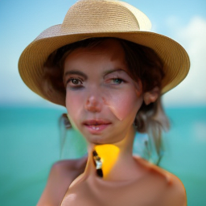
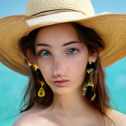
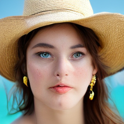

# Fixing Distorted Faces in Supra2-IMG with SFT + Flow-GRPO

Supra2-IMG (~104M-param DiT, rectified flow, 256px, Flan-T5 + SD VAE) often produces distorted faces on portrait prompts. This project fixes that in two stages: supervised finetuning on face data, then Flow-GRPO with a face-quality reward.

Weights: https://huggingface.co/NZUONG/supra2-img-face-grpo

| Base | SFT | Flow-grpo |
|---|---|---|
||||

## Results

500 prompts × 3 seeds per checkpoint, identical initial noise. 95% bootstrap CIs over prompts.

| metric | base | sft | grpo |
|---|---|---|---|
| clean-face rate | 93.1% | 89.2% | **99.5%** |
| mean face det score | 0.792 | 0.781 | **0.844** |
| ImageReward | -0.528 | -0.234 | **0.229** |

- GRPO vs SFT: clean-face +10.3 pts [8.5, 12.2], ImageReward +0.462 [0.425, 0.498], wins 81.1% of paired comparisons.
- SFT improved ImageReward over base but lowered the clean-face rate by 3.8 pts.
- "Clean" = exactly one face


## Files

| file | what it does |
|---|---|
| `inference.py` | Official Supra2-IMG model code and sampler. Every other script imports the architecture from it. |
| `caption_images.py` | Captions a folder of images with Qwen3-VL-8B, writes `x.txt` next to `x.jpg`, and logs unsuitable images (blurry, filtered, watermarked, multi-face) to `rejects.tsv`. |
| `caption_prompt.txt` | The captioning prompt: 40–70 words, framing → subject → clothing → lighting → background. |
| `supra2_finetune.py` | SFT. `prepare` caches VAE latents and Flan-T5 embeddings, `train` runs flow-matching finetuning with EMA and caption dropout for CFG. |
| `supra2_flowgrpo.py` | Flow-GRPO for SupraDiT: SDE rollouts, group-relative advantages, LoRA, built on `diffusion-tinker`. Exports merged weights. |
| `reward_combo.py` | **The reward used for GRPO** (`combo_reward`). See below. |
| `my_reward.py` | MediaPipe face-geometry reward, used inside `combo_reward`. Run it on a real-face folder to build `face_stats.npz`. |
| `gen_benchmark.py` | Generates the benchmark images for several checkpoints from the same noise. |
| `eval_benchmark.py` | Scores them with InsightFace and ImageReward, then writes `metrics.csv`, `summary.md` and sample grids. |
| `benchmark.txt` | The 500 diverse head-and-shoulders eval prompts. |

## Reward

`combo_reward = v + 0.5 * mp`

- `v` (0–1): average P(Yes) from SmolVLM-Instruct (4-bit) over three questions: "Is there a human face in this image?", "Is this a clear, well-formed human face?", "Does this show a person's head and shoulders, centered?"
- `mp` (0–1): MediaPipe landmark ratios (eye distance, mouth width, face aspect ratio, symmetry, etc.) compared with z-scores against real-face statistics. Larger deviation gives a lower score. Images without exactly one face get 0.

The VLM catches gross failures, and the landmark term penalizes subtly off proportions.

## Usage

```bash
python caption_images.py --images ./portraits
python supra2_finetune.py prepare --data ./portraits --cache ./cache
python supra2_finetune.py train --cache ./cache --out runs/sft
python my_reward.py ./real_faces
python supra2_flowgrpo.py --base-ckpt runs/sft/model_final_ema.pt --prompts prompts.txt --reward reward_combo.py:combo_reward --out runs/grpo
python gen_benchmark.py --prompts benchmark.txt --ckpt base=model_final_ema.pt sft=runs/sft/model_final_ema.pt grpo=runs/grpo/model_final_ema.pt
python eval_benchmark.py --bench bench --ckpts base sft grpo
```

Needs `face_landmarker.task` from MediaPipe (download link in the MediaPipe docs).

## Limitations

- Remaining artifacts: hands and half-body framing.
- The face-detector metric overlaps with the reward, so ImageReward is the more independent number.
- The reward measures face quality, not identity or prompt alignment, so reward hacking and lower diversity are possible.
- Trained on FFHQ/SFHQ, so the weights are for non-commercial research use.